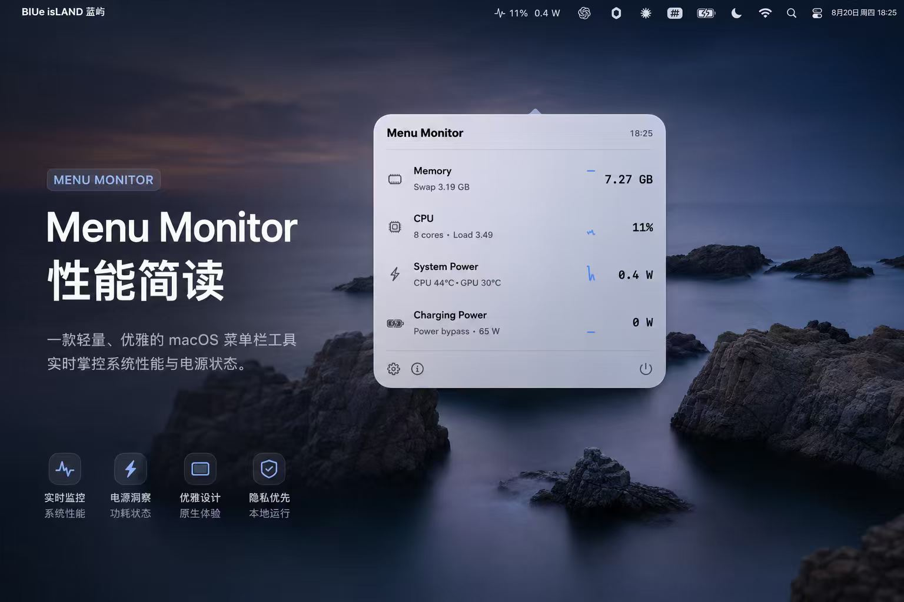
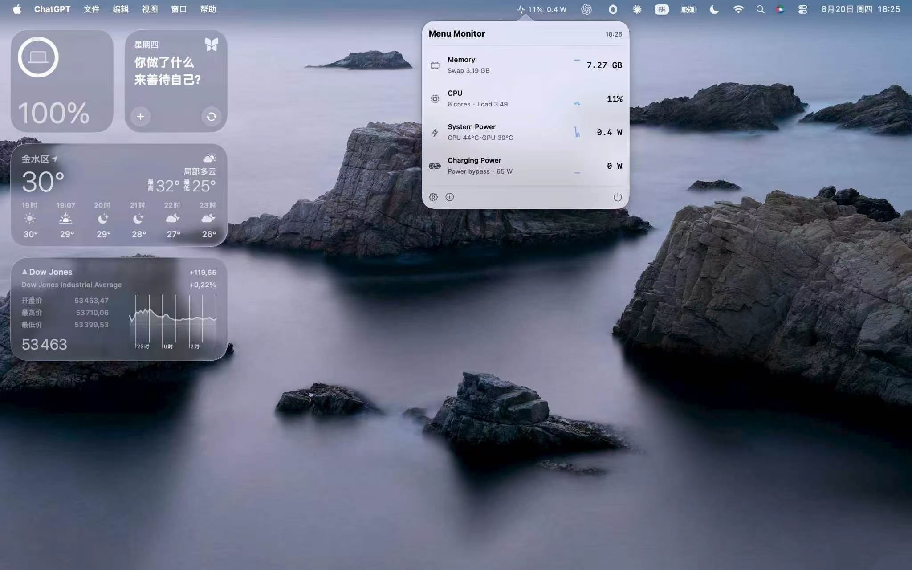
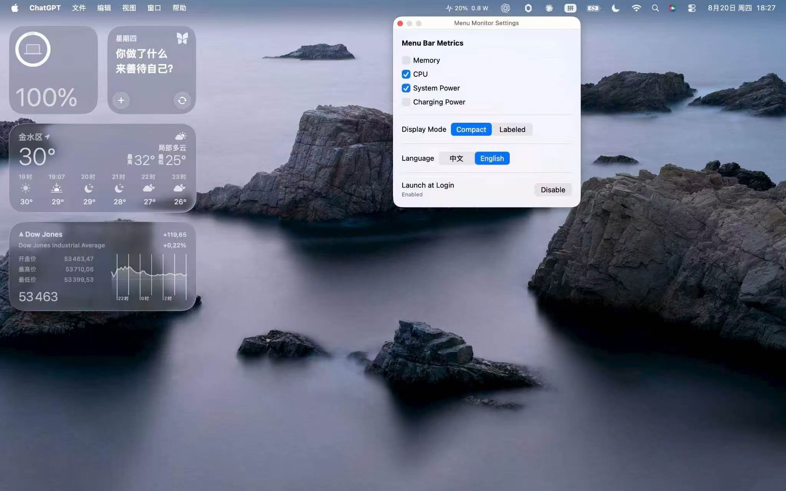

# Menu Monitor · 性能简读

<p><a href="README.md"><u>简体中文</u></a> · <a href="README.en.md"><u>English</u></a> · <a href="README.ar.md"><u>العربية</u></a></p>

<div align="center">
  
</div>

> 一款轻量、优雅的原生 macOS 菜单栏工具，实时掌握系统性能、温度与电源状态。

[](#环境要求)
[](#技术架构)
[](#隐私与本地运行)
[](.github/workflows/validate.yml)
[](LICENSE)

性能简读（Menu Monitor）把常用系统状态放进 macOS 菜单栏。点击图标即可查看内存、CPU、系统功耗、温度、充电功率和最近 60 秒趋势，不需要打开大型监控窗口，也不会在 Dock 中长期占位。

## 一眼掌握 Mac 状态

| 指标 | 实时信息 |
| --- | --- |
| Memory | 内存压力、驻留内存估算、压缩内存、Swap |
| CPU | 总体利用率、逐核利用率、Load Average |
| System Power | CPU / GPU 芯片功耗估算、CPU / GPU 温度 |
| Charging Power | 充电功率、适配器功率、Power bypass 状态 |

菜单栏支持自定义显示项、紧凑模式与带标签模式，并可切换中文和 English。指标进入告警区间时，对应标题会使用系统语义色提示。

## 真实界面

### 菜单栏实时面板

<div align="center">
  
</div>

菜单栏常驻显示当前关心的指标，点击后展开 Liquid Glass 面板，查看完整数值、逐核负载、温度、电源状态和 60 秒趋势图。

### 设置与个性化

<div align="center">
  
</div>

在设置窗口中可以：

- 选择菜单栏要显示的指标；
- 切换 Compact / Labeled 显示模式；
- 切换中文 / English；
- 开启或关闭登录时启动。

## 为什么好用

- **原生 Swift 6 + SwiftUI**：与 macOS 界面体系深度融合，使用 Swift Charts 呈现趋势。
- **轻量常驻**：面板关闭时降低采样频率，打开面板后再加载完整界面和趋势历史。
- **完全离线**：无网络请求、无遥测 SDK、无云同步、无更新检查。
- **无 Electron / WebView**：原生应用架构，不占用 Dock，不引入浏览器运行时。
- **本地采集**：通过 IOKit、IOPS 与 IOReport 读取系统指标。
- **细节完整**：支持温度详情、逐核负载、充电功率、旁路供电识别与标题告警色。

## 下载安装

前往 [Latest Release](https://github.com/origami3521905038-hash/menu-monitor/releases/latest) 下载最近的通用 DMG。

安装流程：

1. 打开 DMG；
2. 双击 `MenuMonitor-Installer.pkg`；
3. 按安装器提示完成安装；
4. 安装后应用会启动菜单栏图标并尝试注册登录时启动。

也可以直接把 `MenuMonitor.app` 拖入“应用程序”。此方式不会自动注册登录项。

## 从源码构建

环境要求：macOS 26+、Xcode 26+、Swift 6.2+。

```bash
git clone https://github.com/origami3521905038-hash/menu-monitor.git
cd menu-monitor
swift test -c debug
./install.sh
```

只构建、不安装：

```bash
./build.sh
```

生成 DMG：

```bash
./package-dmg.sh
```

生成安装器包：

```bash
./package-pkg.sh
```

卸载：

```bash
./uninstall.sh
```

## 隐私与本地运行

- 指标采集只访问本机系统接口。
- 应用不发起网络请求，不包含遥测、统计 SDK 或云同步。
- 指标采集不要求管理员权限。
- 项目没有 SMC Helper、守护进程或持续 root 进程。
- 复制到 `/Applications` 时，系统可能请求一次安装授权，与指标读取无关。

## 实测运行开销

测试环境：macOS 26.5.2 · Apple Silicon 8 核。

| 项目 | 实测结果 |
| --- | --- |
| 面板关闭时 CPU 采样 | `0.0% / 0.8% / 0.0% / 1.2% / 0.6%` |
| CPU 峰值 | 约 `1.2%` |
| 进程 footprint 峰值 | 约 `13 MB` |
| `ps` RSS | 约 `34–40 MB`，包含共享映射 |

## 数据口径

System Power 是基于 CPU、GPU 及可用 DRAM 能量计数推导出的芯片功耗估算，不等同于墙上功耗、适配器输入功率或整机电表读数。

温度、功耗通道和旁路供电状态来自当前硬件与系统接口。界面会根据实际可用信号展示对应信息。

## 技术架构

```text
MenuMonitorApp      AppKit accessory app / menu bar / preferences
MenuMonitorUI       SwiftUI + Swift Charts Liquid Glass panel
MenuMonitorCore     metrics collectors and sampling coordination
CIOReportRuntime    isolated IOReport C runtime
CIOHIDTemperature   isolated IOHID temperature runtime
MenuMonitorProbe    command-line metric validation
```

## 构建与仓库校验

```bash
swift build -c debug
python3 Tests/validate_repo.py
```

源码包含指标状态、时间单调性、功耗状态、旁路供电条件与数值格式测试；项目完整 Xcode 工具链可以执行 `swift test -c debug`。GitHub Actions 会自动执行 Swift 构建、文档链接和仓库结构校验。

## 项目文档

- [GitHub 项目介绍](GITHUB_PROJECT_INTRO.md)
- [发布检查清单](GITHUB_RELEASE_CHECKLIST.md)
- [v1.0.1 发布说明](RELEASE_NOTES-v1.0.1.md)
- [安全说明](SECURITY.md)
- [参与共建](CONTRIBUTING.md)

## License

MIT License。详见 [LICENSE](LICENSE)。
